# 💧 JALTRACKER
### Enterprise Smart Water Consumption, Conservation & Automated Billing Platform

[](https://spring.io/projects/spring-boot)
[](https://openjdk.org/)
[](https://react.dev/)
[](https://vitejs.dev/)
[](https://tailwindcss.com/)
[](https://www.postgresql.org/)
[](https://www.rabbitmq.com/)
[](https://redis.io/)
[](https://www.docker.com/)
[](LICENSE)

---

## 📌 Executive Summary

**JALTRACKER** is an enterprise-grade full-stack water governance and automated utility billing platform designed for modern housing societies, residential apartment complexes, and commercial properties.

Conventional property management systems rely on rigid flat-rate water charges, which penalize low-consumption residents and mask underground pipeline leaks. JALTRACKER resolves this through **automated tiered tariffs**, **proportional shared tanker cost apportionment**, **statistical 2-sigma ($\mu \pm 2\sigma$) leak detection**, **multi-channel 2FA security (WhatsApp + Email)**, and **asynchronous message queues for instant PDF invoice rendering**.

---

## 📸 Visual Showcase & Feature Walkthrough

### 1. Enterprise Security & Multi-Channel 2FA Authentication
Secured with **Spring Security 6**, stateless **JWT**, **Bucket4j rate-limiting** (5 req/min on public auth routes), and real-time **Two-Factor Authentication (OTP)** delivered via Twilio WhatsApp and Email.

| Account Sign In & Resident Onboarding | Two-Factor OTP Verification Modal |
| :---: | :---: |
| 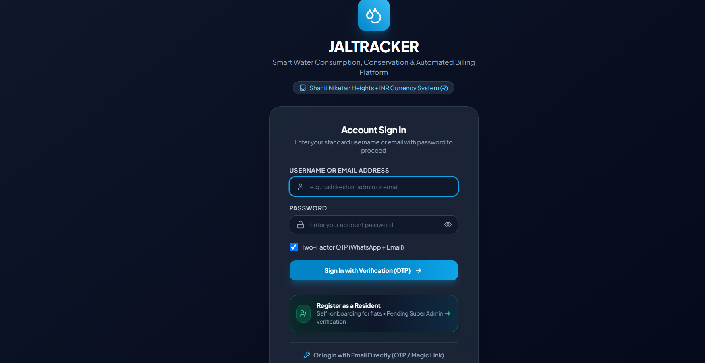 | 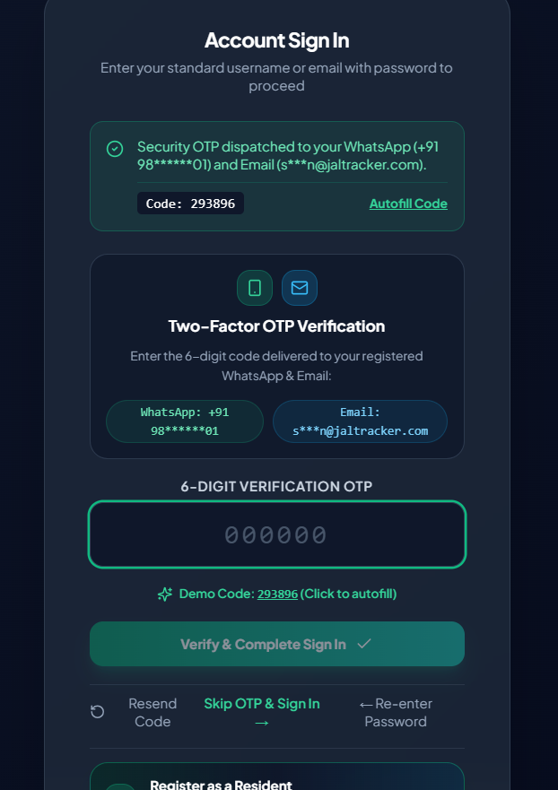 |
| *Sign in with credentials, one-click demo profiles, or register new flats.* | *6-digit OTP dispatched to WhatsApp (+91) and verified email.* |

---

### 2. Apartment Administration Console & Real-Time Leak Warnings
The administrative command center provides real-time telemetric monitoring, active billing cycle tracking, shared water cost summaries, and automated anomaly notifications.

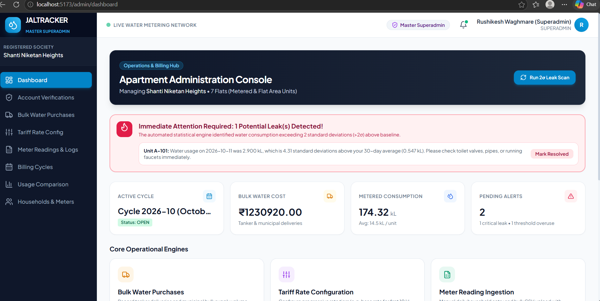
*Admin Dashboard displaying active cycle status, ₹12.3 Lakh bulk water pool, metered usage summary, and critical 2-sigma leak warning.*

---

### 3. All-Household Usage Comparison Analytics
Powered by **Recharts**, this visualization benchmarks every flat's metered volume against the complex average, dynamically color-coding standard, above-average, and high-leak suspect units.

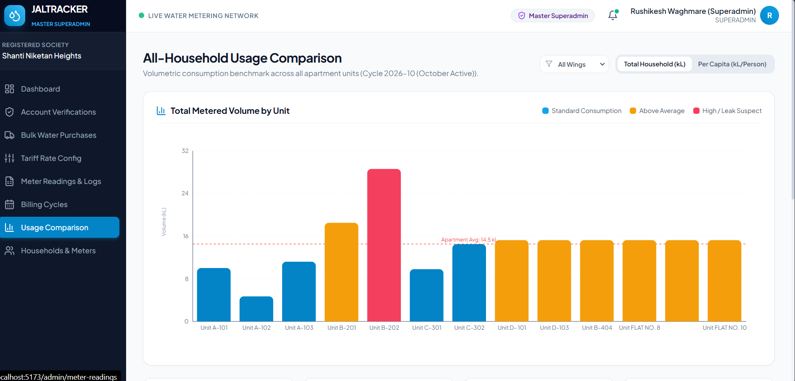
*Interactive volume comparison by unit with apartment average baseline and per-capita toggles.*

---

### 4. Tariff Rate Configuration with Live Calculation Simulator
Property admins can configure multi-tier progressive tariff schedules (lifeline, normal, high, surcharge) and test calculations in real time using an interactive volume slider.

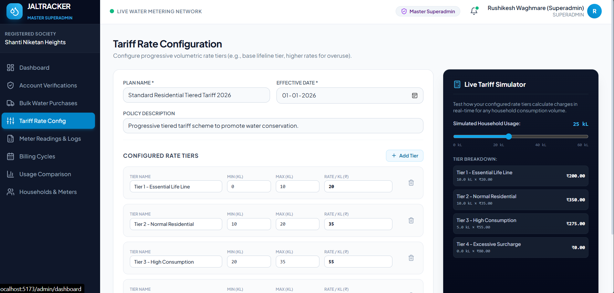
*Configured rate tiers (₹20 to ₹80/kL) paired with an instant breakdown preview.*

---

### 5. Supplemental Bulk Water Procurement (Tanker & Municipal)
Log supplemental private tanker deliveries and municipal bulk supplies. The system aggregates batch costs and proportionally distributes shared water costs across all society residents.

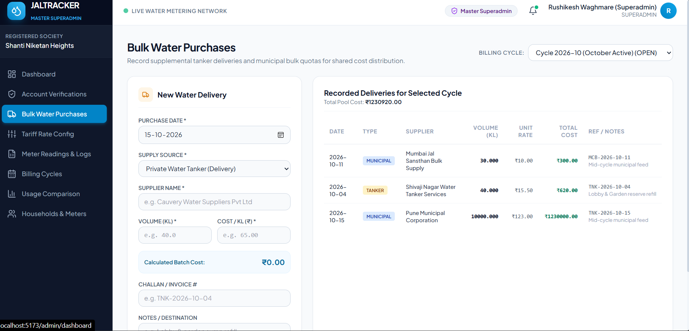
*Tracking municipal bulk quotas and tanker deliveries with invoice numbers and volume records.*

---

### 6. Meter Reading Management & Anomaly Tagging
Supports daily manual meter reading logs, cumulative dial tracking, consumption difference calculation, and bulk CSV uploads with row-level diagnostics.

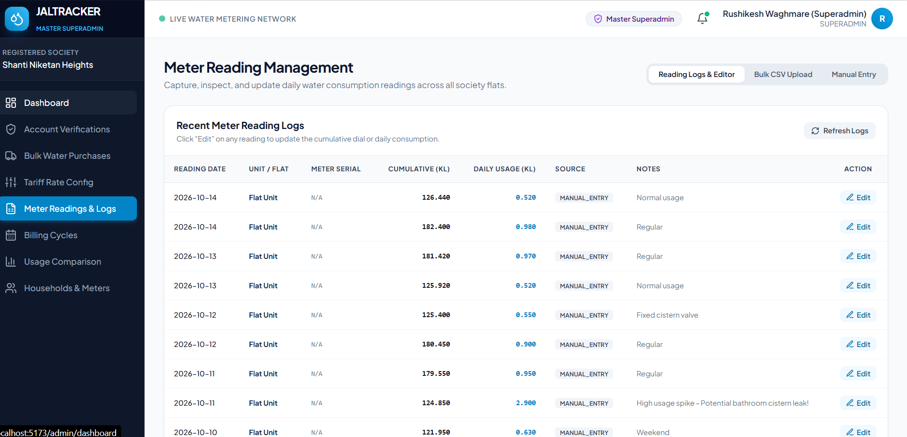
*Daily logs showing automated consumption calculations and leak detection tags.*

---

### 7. Governance, Resident Approvals & Directory
Manages resident onboarding workflows, flats verification, digital water meter serial assignments, and customized daily consumption thresholds.

| Resident Approval & Verification | Households & Digital Water Meters Directory |
| :---: | :---: |
| 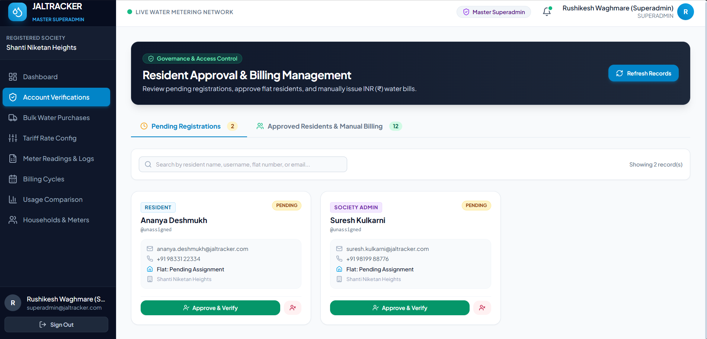 | 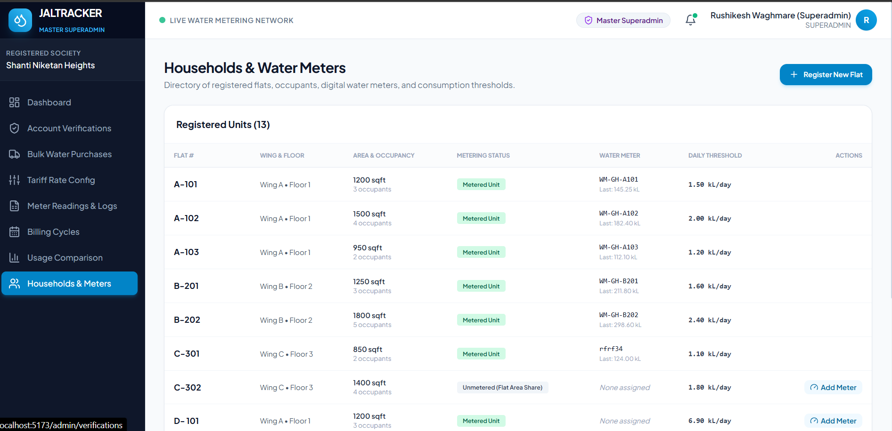 |
| *Review, verify, and approve pending resident applications.* | *13+ units tracked with square footage, occupancy, and meter serials.* |

---

### 8. Billing Cycle Lifecycle & Asynchronous Invoicing
Manage monthly billing periods (Open, Preview, Finalize, Archive). When finalizing, **RabbitMQ message queues** handle background Apache PDFBox invoice generation and dispatch.

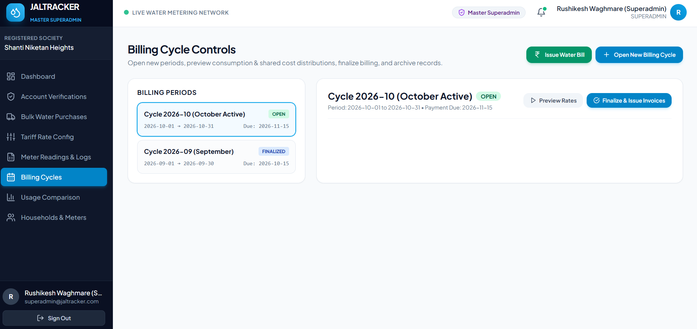
*Billing periods control center with rate preview and one-click invoice finalization.*

---

## 🏗️ System Architecture

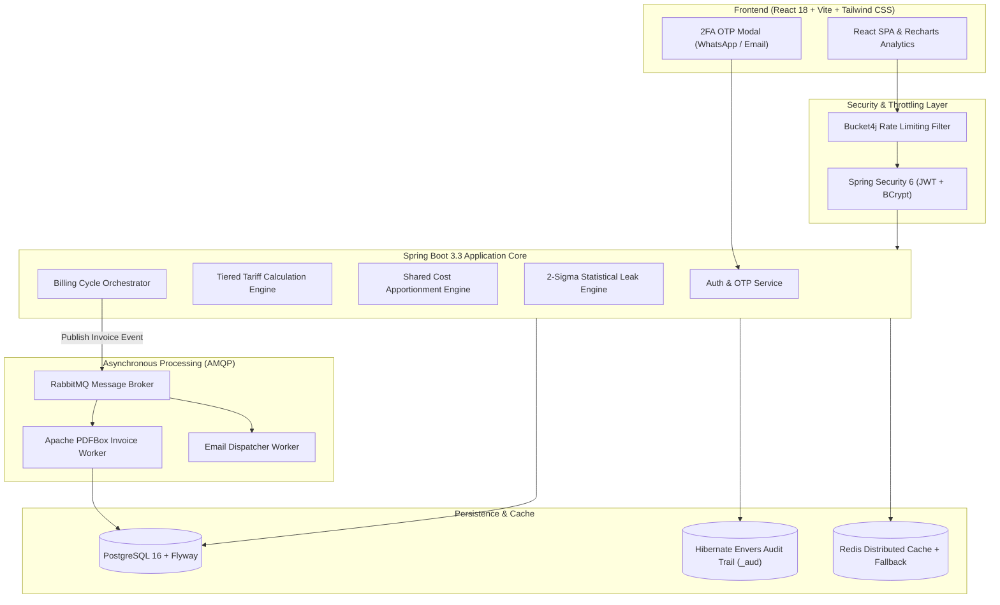

---

## 🌟 Key Technical Highlights

1. **Progressive Multi-Tier Tariff Engine**:
   - Step-by-step tiered calculation (e.g., Tier 1: 0–10 kL @ ₹20, Tier 2: 10–20 kL @ ₹35, Tier 3: 20–35 kL @ ₹55, Tier 4: >35 kL @ ₹80).
   - Generates transparent, itemized receipts for every invoice.

2. **Proportional Cost Apportionment Algorithm**:
   - Automatically distributes shared bulk water purchases (tanker supply + common area water) proportionally by metered consumption.
   - Intelligently falls back to flat area (sqft) proportional distribution for unmetered units.

3. **Statistical 2-Sigma ($\mu \pm 2\sigma$) Leak Detection**:
   - Automated nightly `@Scheduled` cron job computes a 30-day baseline mean ($\mu$) and standard deviation ($\sigma$) per flat.
   - Flags statistical spikes ($> \mu + 2\sigma$) as potential pipe leaks, notifying admins and residents immediately.

4. **Asynchronous Message Broker Pipeline (RabbitMQ)**:
   - Finalizing billing cycles produces AMQP messages to offload CPU/IO-heavy PDF invoice generation (**Apache PDFBox 3.0**) and email dispatches to background workers.

5. **Enterprise Security & Data Lineage**:
   - **Bucket4j**: Prevents brute-force attacks by rate-limiting public authentication endpoints to 5 requests/minute per client IP.
   - **Twilio 2FA**: Two-factor OTP codes delivered to registered WhatsApp numbers and verified email addresses.
   - **Hibernate Envers**: Automated revision history tables (`_aud`) tracking all meter reading edits and account status modifications.
   - **Resilient Redis Caching**: Custom `CacheErrorHandler` ensures the system gracefully degrades to database queries if Redis is offline.

---

## 🚀 Quick Start Guide

### Prerequisites
- **Java 17+** (JDK 17)
- **Node.js 18+** & npm
- **Maven 3.9+**
- **PostgreSQL 16** (or Docker)

---

### Step 1: Clone the Repository
```bash
git clone https://github.com/YOUR_USERNAME/jaltracker-water-platform.git
cd jaltracker-water-platform
```

---

### Step 2: Configure Environment Variables
Copy `.env.example` to `.env` in the root directory:
```powershell
Copy-Item .env.example .env
```
Key defaults provided in `.env`:
```properties
DB_HOST=localhost
DB_PORT=5432
DB_NAME=waterbill
DB_USER=postgres
DB_PASS=root
JWT_SECRET=404E635266556A586E3272357538782F413F4428472B4B6250645367566B5970
TWILIO_SIMULATION_MODE=true
```

---

### Step 3: Run the Backend
```powershell
cd backend
mvn clean spring-boot:run
```
*The Spring Boot server will start at `http://localhost:8080`. Flyway automatically runs database migrations and seeds demo data on launch.*

---

### Step 4: Run the Frontend
In a new terminal window:
```powershell
cd frontend
npm install
npm run dev
```
*The React application will launch at `http://localhost:5173`.*

---

### Step 5: (Optional) Run Infrastructure via Docker Compose
To spin up PostgreSQL, Redis, and RabbitMQ in containers:
```bash
docker-compose up -d
```

---

## 🔑 Pre-Configured Demo Credentials

| Role | Username / Email | Password | Scope & Access |
|---|---|---|---|
| **Master Superadmin** | `superadmin@jaltracker.com` | `Superadmin@123` | Full system control, billing finalization, resident approvals |
| **Society Admin** | `admin@waterbill.com` | `Admin@123` | Society console, bulk purchases, meter reading logs |
| **Resident (Metered + Leak Spike)** | `rushikesh` / `resident1@waterbill.com` | `Resident@123` | Flat A-101 (Has 2σ anomaly spike on Oct 11) |
| **Resident (Standard Metered)** | `resident2@waterbill.com` | `Resident@123` | Flat A-102 (Family of 4, normal consumption) |
| **Resident (Unmetered Flat Area)** | `resident3@waterbill.com` | `Resident@123` | Flat C-302 (Unmetered unit, flat area distribution) |

*Note: In local simulation mode (`TWILIO_SIMULATION_MODE=true`), OTP verification codes are logged directly to the backend console and displayed with 1-click autofill in the UI.*

---

## 📡 Core API Endpoints

| Method | Endpoint | Description |
|---|---|---|
| `POST` | `/api/auth/login` | Authenticate user & issue JWT |
| `POST` | `/api/otp/send-otp` | Dispatch 6-digit 2FA OTP via WhatsApp / Email |
| `POST` | `/api/otp/validate-otp` | Validate 2FA OTP code and authorize login |
| `GET` | `/api/admin/analytics/usage-comparison` | Household consumption benchmark data |
| `POST` | `/api/admin/billing-cycles/{id}/finalize` | Trigger RabbitMQ async invoice generation |
| `POST` | `/api/water-usage/manual` | Record single flat meter reading |
| `POST` | `/api/water-usage/bulk-csv` | Ingest meter readings via CSV upload |
| `GET` | `/api/invoices/{id}/pdf` | Stream downloadable PDF statement |
| `GET` | `/actuator/health` | Application health and service status |

---

## 📄 License
This project is licensed under the [MIT License](LICENSE).
